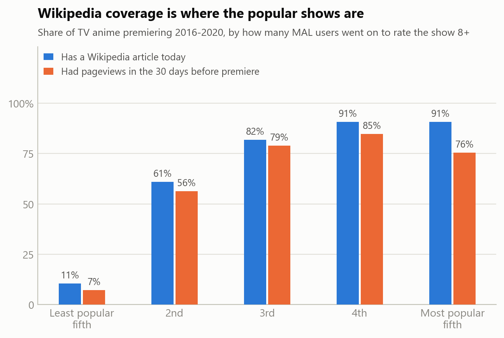
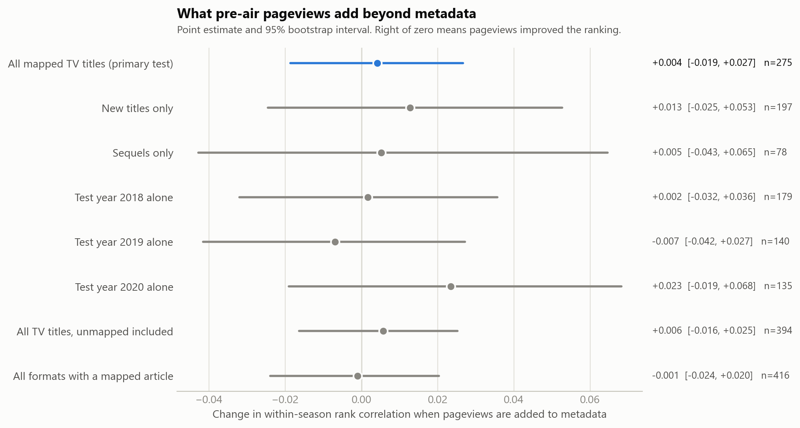
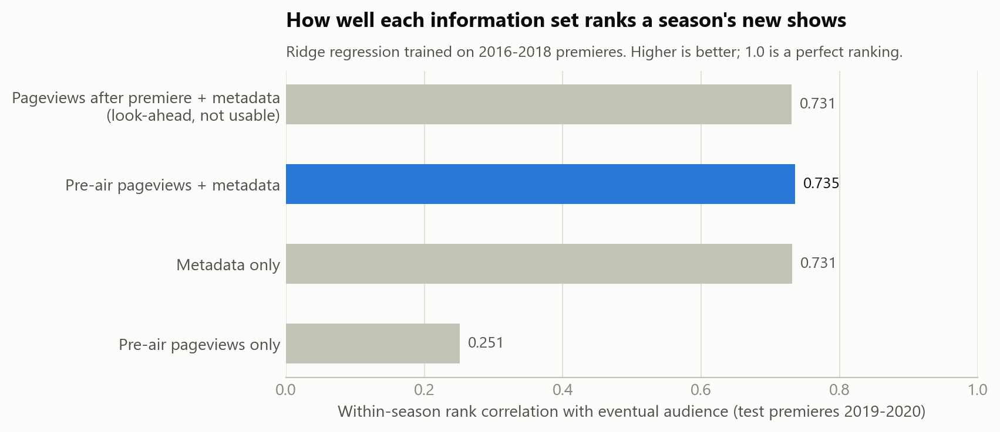
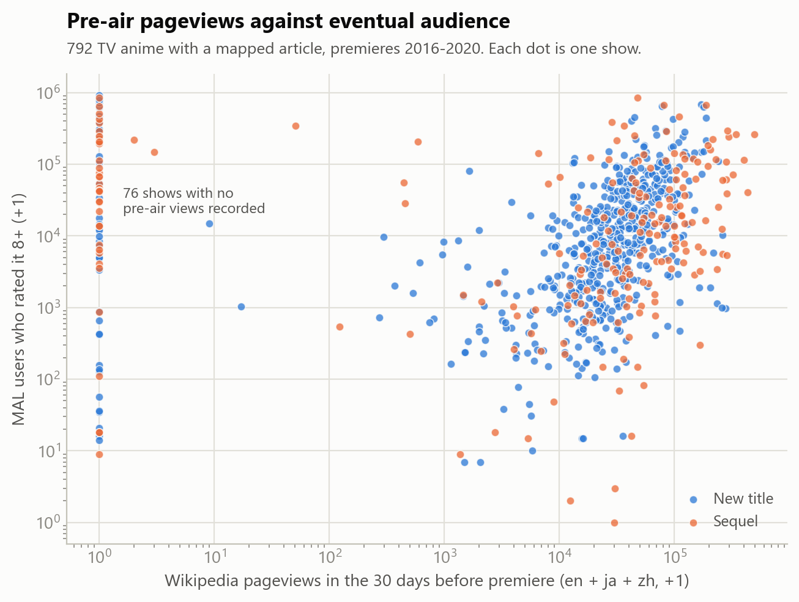
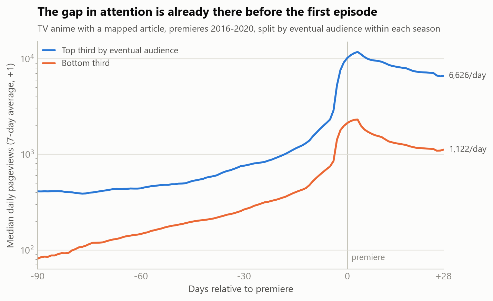
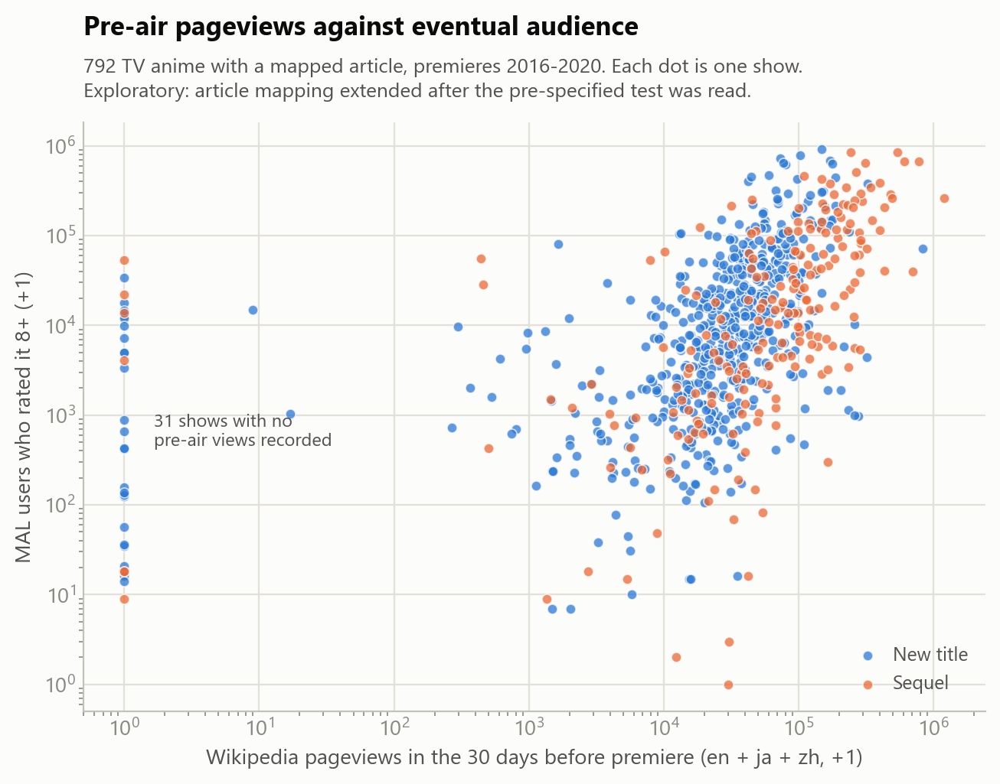
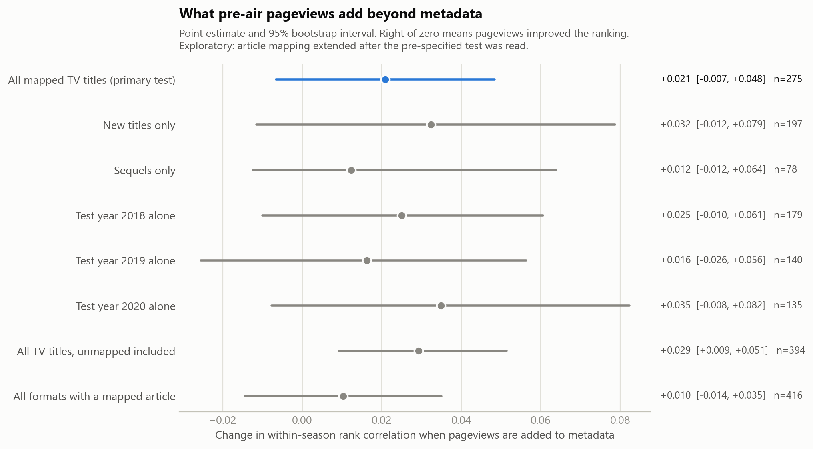
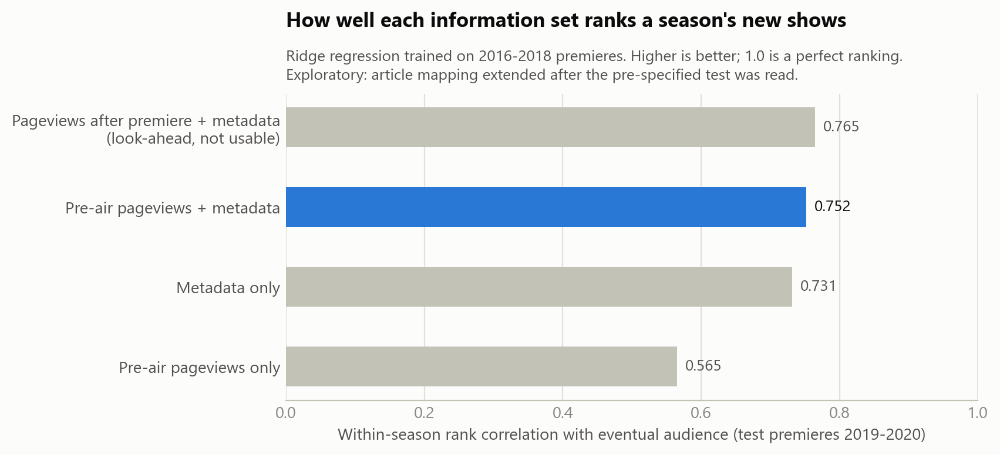
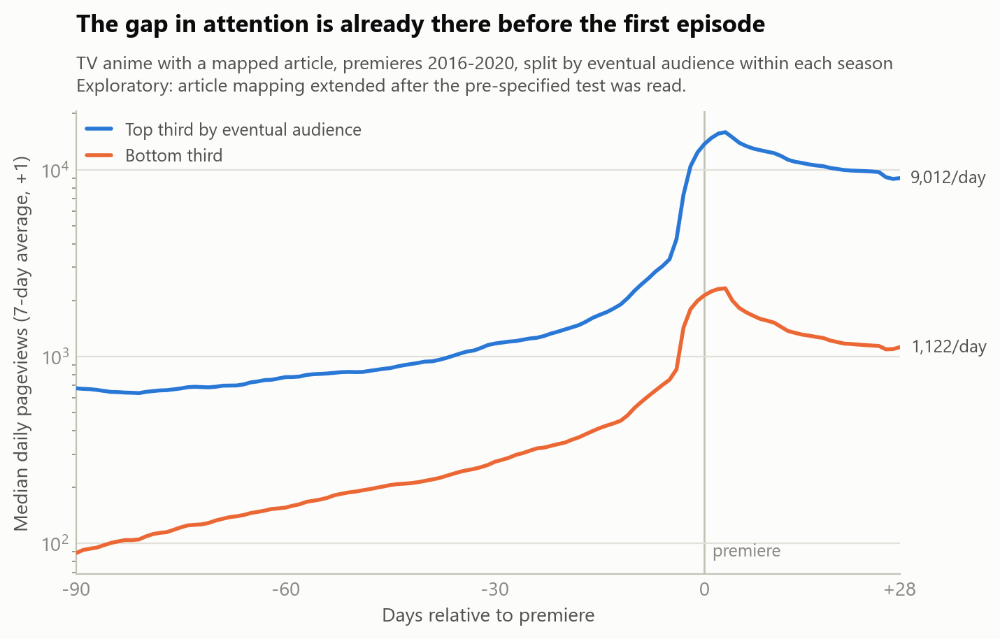
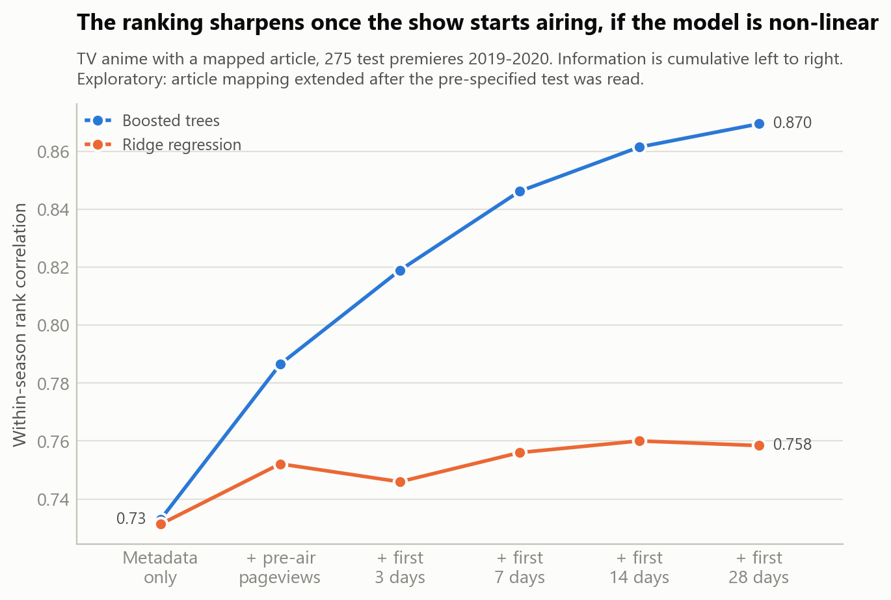

# Feasibility check: do pre-air Wikipedia pageviews predict an anime's audience beyond metadata?

**Verdict against the rule fixed in advance: FAIL.** Adding pre-air pageviews to the metadata baseline changes the within-season rank correlation by **+0.004 [-0.019, +0.027]** (point estimate and 95% paired bootstrap interval, 275 test titles).

This file is generated by `src/report.py` from `results/feasibility_report.json`. No number in it is typed by hand.

## 1. Question and decision rule

A new anime has no ratings on the day it premieres, so a collaborative-filtering recommender cannot score it. Metadata (studio, source material, franchise) is known in advance. So is the attention the show's Wikipedia article received in the weeks before the premiere. The question is whether that attention predicts how many people end up liking the show **over and above** what metadata already predicts.

All definitions were fixed in `src/analyze.py` before any feature was compared against the outcome:

- **Outcome:** log1p(Score-8 + Score-9 + Score-10), MAL snapshot of early 2021.
- **Alt-data features:** per language (en, ja, zh), log pageviews on days -30 to -1 and on days -90 to -31 relative to the premiere, summed over the title's own article and its parent (series or source-work) article.
- **Baseline:** type, source, age rating, genres, episode count, premiere quarter, studio prior, franchise prior.
- **Split:** train on premieres 2016-01-01 to 2018-12-31; test on premieres 2019-01-01 to 2020-12-31. Temporal, never random.
- **Model:** ridge regression; scaling and penalty chosen on the training set only.
- **Primary metric:** Spearman rank correlation computed inside each premiere season, then averaged.
- **Decision rule:** PASS if delta > 0 and the 95% bootstrap lower bound > 0; otherwise FAIL. 2000 paired bootstrap draws, seed 12345.

## 2. Data

| Source | What | Retrieved | Identity |
|---|---:|---:|---:|
| Anime Recommendation Database 2020 (Kaggle, CC0) | `anime.csv`, MAL catalog snapshot of early 2021 | copied from the Anime Compass archive | SHA-256 `6e6d723f3e021e08…` |
| Wikidata SPARQL | 7,303 items carrying P4086 (MyAnimeList anime ID) | 2026-10-04T18:51:10+00:00 | SHA-256 `e016185025a2e685…` |
| Wikimedia pageviews API | daily views, 3,168 articles, 2015-07-01 to 2021-03-31, agent = user | 2026-10-04T19:29:42+00:00 | status ok: 2,853, no_data: 315 |

## 3. Coverage: where the holes are

Share of cohort titles at each mapping stage. "Pre-air views > 0" is the only column that is point-in-time; the others describe today's Wikidata and Wikipedia.

**By format**

| Format | n | In Wikidata | English | Japanese | Chinese | Any article | Pre-air views > 0 |
|---|---:|---:|---:|---:|---:|---:|---:|
| Movie | 484 | 43.4% | 38.0% | 38.4% | 36.2% | 41.7% | 38.8% |
| ONA | 1048 | 11.3% | 7.8% | 8.8% | 7.4% | 10.3% | 6.9% |
| OVA | 383 | 7.6% | 6.3% | 6.5% | 5.7% | 6.8% | 6.3% |
| Special | 436 | 3.2% | 1.8% | 2.8% | 1.8% | 2.8% | 2.1% |
| TV | 1183 | 68.4% | 60.9% | 65.1% | 59.0% | 67.0% | 60.5% |

**TV titles by eventual popularity** (fifths of the outcome)

| Popularity fifth | n | In Wikidata | English | Japanese | Chinese | Any article | Pre-air views > 0 |
|---|---:|---:|---:|---:|---:|---:|---:|
| Q1_least | 237 | 12.2% | 5.5% | 9.7% | 7.2% | 10.5% | 7.2% |
| Q2 | 236 | 63.1% | 45.8% | 59.8% | 41.1% | 61.0% | 56.4% |
| Q3 | 237 | 82.3% | 77.6% | 81.0% | 75.1% | 81.9% | 78.9% |
| Q4 | 236 | 92.0% | 88.1% | 88.1% | 87.3% | 90.7% | 84.8% |
| Q5_most | 237 | 92.4% | 87.3% | 86.9% | 84.4% | 90.7% | 75.5% |

**TV titles, new versus sequel**

| Kind | n | In Wikidata | English | Japanese | Chinese | Any article | Pre-air views > 0 |
|---|---:|---:|---:|---:|---:|---:|---:|
| new_ip | 770 | 76.6% | 69.3% | 74.3% | 66.9% | 75.4% | 70.3% |
| sequel | 413 | 53.0% | 45.0% | 47.9% | 44.3% | 51.1% | 42.4% |



## 4. Primary result

TV titles with a mapped article. Train 517, test 275.

| Information set | Within-season Spearman | Within-season R² | Top-quintile hit rate | NDCG@10 |
|---|---:|---:|---:|---:|
| Metadata only (baseline) | 0.731 | 0.616 | 0.556 | 0.731 |
| Metadata + pre-air pageviews | 0.735 | 0.630 | 0.500 | 0.721 |
| Pre-air pageviews only | 0.251 | 0.082 | 0.315 | 0.305 |

Change from adding pre-air pageviews to metadata, with 95% paired bootstrap intervals:

| Metric | Metadata + pageviews minus metadata |
|---|---:|
| Within-season Spearman (primary) | +0.004 [-0.019, +0.027] |
| Within-season R² | +0.014 [-0.003, +0.031] |
| Top-quintile hit rate | -0.056 [-0.074, +0.074] |
| NDCG@10 | -0.010 [-0.031, +0.037] |





## 5. Secondary analyses (not part of the decision)

**New titles versus sequels** (primary sample, ridge)

| Subgroup | n test | Metadata | Metadata + pageviews | Change [95% CI] |
|---|---:|---:|---:|---:|
| New titles | 197 | 0.624 | 0.636 | +0.013 [-0.025, +0.053] |
| Sequels | 78 | 0.838 | 0.843 | +0.005 [-0.043, +0.065] |

**One test year at a time** (train on all earlier premieres)

| Test year | n train | n test | Metadata | Metadata + pageviews | Change [95% CI] |
|---|---:|---:|---:|---:|---:|
| 2018 | 338 | 179 | 0.584 | 0.586 | +0.002 [-0.032, +0.036] |
| 2019 | 517 | 140 | 0.713 | 0.706 | -0.007 [-0.042, +0.027] |
| 2020 | 657 | 135 | 0.730 | 0.754 | +0.023 [-0.019, +0.068] |

**Other samples and a non-linear model**

| Sample | Model | n test | Metadata | Metadata + pageviews | Change [95% CI] |
|---|---:|---:|---:|---:|---:|
| TV, mapped to an article (primary) | ridge | 275 | 0.731 | 0.735 | +0.004 [-0.019, +0.027] |
| TV, mapped to an article (primary) | boosted | 275 | 0.733 | 0.788 | +0.055 [-0.004, +0.114] |
| TV, all titles (unmapped get zero views) | ridge | 394 | 0.839 | 0.845 | +0.006 [-0.016, +0.025] |
| TV, all titles (unmapped get zero views) | boosted | 394 | 0.839 | 0.881 | +0.042 [+0.015, +0.073] |
| All formats, mapped to an article | ridge | 416 | 0.763 | 0.762 | -0.001 [-0.024, +0.020] |
| All formats, mapped to an article | boosted | 416 | 0.751 | 0.795 | +0.044 [+0.009, +0.083] |

**Which language carries the signal** (primary sample, ridge; each row adds one language's two features to metadata)

| Added to metadata | Within-season Spearman | Change [95% CI] |
|---|---:|---:|
| Metadata + English pageviews | 0.727 | -0.004 [-0.017, +0.007] |
| Metadata + Japanese pageviews | 0.732 | +0.001 [-0.015, +0.018] |
| Metadata + Chinese pageviews | 0.727 | -0.004 [-0.019, +0.012] |
| Metadata + pre-air pageviews | 0.735 | +0.004 [-0.019, +0.027] |

**Single-feature rank correlation with the outcome** (primary sample, not within season)

| Feature | Train 2016-2018 | Test 2019-2020 |
|---|---:|---:|
| `pv_pre30_en` | 0.250 | 0.256 |
| `pv_base_en` | 0.217 | 0.209 |
| `pv_pre30_ja` | 0.376 | 0.266 |
| `pv_base_ja` | 0.276 | 0.151 |
| `pv_pre30_zh` | 0.313 | 0.260 |
| `pv_base_zh` | 0.252 | 0.196 |
| `franchise_prior` | 0.736 | 0.822 |
| `studio_prior` | 0.428 | 0.393 |





## 6. Look-ahead demonstration

Replacing the pre-air window with pageviews from the first 28 days **after** the premiere gives a within-season Spearman of 0.731, against 0.735 for the pre-air window. That arm is not a result. It uses information a cold-start system would not have, and it is shown only to size how much an accidental window error would flatter the model.

## 7. A measurement defect found after the test

Of the 215 mapped TV titles in the most popular fifth, **36 show no pre-air pageviews in any language**. The largest are: Boku no Hero Academia; Boku no Hero Academia 2nd Season; Kimetsu no Yaiba; Re:Zero kara Hajimeru Isekai Seikatsu; Boku no Hero Academia 3rd Season; Kono Subarashii Sekai ni Shukufuku wo!; Kono Subarashii Sekai ni Shukufuku wo! 2; Kaguya-sama wa Kokurasetai: Tensai-tachi no Renai Zunousen.

These are not shows nobody looked up. The pre-specified mapping took a title's own article plus its *nearest* parent, which for these titles resolved to "… season 1" and "… (TV series)" pages. Both were split out of the main article years after the premiere, so they had no views beforehand. The attention was on the main article, which Wikidata models as the source manga, one step further up the chain. The test as specified therefore could not see the signal for exactly the titles where it should be strongest, which biases it toward finding nothing.


## 8. Exploratory (post hoc): corrected article mapping

**This section was produced after the result in section 4 had been read. It cannot change that verdict.** The mapping is extended on principle, not by trying alternatives against the outcome: a title's attention is summed over its own article, its series article and the article of the work it is based on (`src/map_wikipedia_exploratory.py`). The rows, split, features, model and metric are unchanged.

| TV titles with a mapped article | Pre-specified mapping | Exploratory mapping |
|---|---:|---:|
| Top-fifth mapped titles with zero pre-air views | 36 | 1 |
| Pageviews only, within-season Spearman (ridge) | 0.251 | 0.565 |
| Metadata only (ridge) | 0.731 | 0.731 |
| Metadata + pageviews (ridge) | 0.735 | 0.752 |
| **Change from adding pageviews, ridge (the pre-specified comparison)** | +0.004 [-0.019, +0.027] | +0.021 [-0.007, +0.048] |
| Change from adding pageviews, boosted trees | +0.055 [-0.004, +0.114] | +0.054 [-0.008, +0.119] |
| Change, new titles only (ridge) | +0.013 [-0.025, +0.053] | +0.032 [-0.012, +0.079] |
| Change, all TV titles incl. unmapped (ridge) | +0.006 [-0.016, +0.025] | +0.029 [+0.009, +0.051] |
| Change in NDCG@10, boosted trees | +0.003 [-0.033, +0.102] | +0.059 [-0.003, +0.144] |
| Look-ahead arm: change from post-air pageviews, boosted trees | +0.107 [+0.037, +0.179] | +0.128 [+0.062, +0.199] |
| English pre-air views, rank correlation with outcome (test) | 0.256 | 0.514 |
| Japanese pre-air views, rank correlation with outcome (test) | 0.266 | 0.590 |
| Chinese pre-air views, rank correlation with outcome (test) | 0.260 | 0.555 |

Under the corrected mapping the pre-specified comparison gives +0.021 [-0.007, +0.048], which still does not meet the decision rule. One test year at a time:

| Test year | n test | Metadata | Metadata + pageviews | Change [95% CI] |
|---|---:|---:|---:|---:|
| 2018 | 179 | 0.584 | 0.609 | +0.025 [-0.010, +0.061] |
| 2019 | 140 | 0.713 | 0.730 | +0.016 [-0.026, +0.056] |
| 2020 | 135 | 0.730 | 0.765 | +0.035 [-0.008, +0.082] |









## 9. Exploratory (post hoc): the first days after the premiere

**Also produced after the results above had been read.** The look-ahead arm showed that post-air pageviews carry more signal than pre-air ones, which raises a different cold-start question: a week after the premiere a show still has almost no ratings, but its first-week attention is known. Using days 0 to 6 is not look-ahead for a decision taken on day 7. Mapping, sample, split, models, metric and bootstrap are as in section 8; definitions are in `src/analyze_after_premiere.py`.

**Ridge regression**

| Information (cumulative) | Within-season Spearman | Top-quintile hit rate | NDCG@10 | Change vs metadata [95% CI] | Change vs metadata + pre-air [95% CI] |
|---|---:|---:|---:|---:|---:|
| Metadata only | 0.731 | 0.556 | 0.731 | — | — |
| + pre-air pageviews | 0.752 | 0.537 | 0.728 | +0.021 [-0.007, +0.048] | — |
| + first 3 days | 0.746 | 0.519 | 0.716 | +0.015 [-0.021, +0.049] | -0.006 [-0.034, +0.021] |
| + first 7 days | 0.756 | 0.537 | 0.719 | +0.025 [-0.008, +0.059] | +0.004 [-0.019, +0.027] |
| + first 14 days | 0.760 | 0.537 | 0.736 | +0.029 [-0.004, +0.063] | +0.008 [-0.014, +0.031] |
| + first 28 days | 0.758 | 0.556 | 0.732 | +0.027 [-0.004, +0.060] | +0.006 [-0.014, +0.028] |

**Boosted trees**

| Information (cumulative) | Within-season Spearman | Top-quintile hit rate | NDCG@10 | Change vs metadata [95% CI] | Change vs metadata + pre-air [95% CI] |
|---|---:|---:|---:|---:|---:|
| Metadata only | 0.733 | 0.611 | 0.797 | — | — |
| + pre-air pageviews | 0.786 | 0.648 | 0.856 | +0.054 [-0.008, +0.119] | — |
| + first 3 days | 0.819 | 0.704 | 0.834 | +0.086 [+0.021, +0.156] | +0.032 [-0.016, +0.083] |
| + first 7 days | 0.846 | 0.704 | 0.858 | +0.113 [+0.048, +0.182] | +0.060 [+0.012, +0.113] |
| + first 14 days | 0.861 | 0.741 | 0.856 | +0.129 [+0.064, +0.197] | +0.075 [+0.029, +0.128] |
| + first 28 days | 0.870 | 0.741 | 0.841 | +0.137 [+0.073, +0.208] | +0.083 [+0.037, +0.136] |

**One test year at a time**, metadata + pre-air + first 7 days against metadata only

| Test year | n test | Ridge: change [95% CI] | Boosted trees: change [95% CI] |
|---|---:|---:|---:|
| 2018 | 179 | +0.033 [-0.011, +0.077] | +0.098 [+0.012, +0.188] |
| 2019 | 140 | +0.004 [-0.040, +0.049] | +0.135 [+0.035, +0.241] |
| 2020 | 135 | +0.058 [+0.013, +0.113] | +0.102 [+0.025, +0.190] |

The two models disagree. Ridge regression finds no reliable gain from first-week pageviews; boosted trees find one at every horizon. Both are reported because choosing between them after the fact would be choosing the answer. A system running on day 7 could also read MAL's own first-week member counts, which this snapshot cannot reconstruct, so the comparison against the strongest in-domain signal is missing.



## 10. Limitations

- **Coverage carries look-ahead.** Pageview counts are point-in-time, but whether a title is in Wikidata today depends on how notable it became. The primary sample conditions on being mapped, so its results describe titles that have an article, not all new anime.
- **Page moves understate early views.** Views are logged under the title a page had on that day. This can only weaken the measured pre-air signal.
- **The parent article is often the manga or franchise page.** For those titles the feature measures attention to the property, not to the anime adaptation specifically.
- **The outcome is one community.** MAL users skew toward English-speaking, engaged fans. The snapshot is from early 2021, so late-2020 premieres had little time to collect ratings; ranking within a season limits but does not remove this.
- **The baseline's priors also look ahead slightly.** Studio and franchise priors use earlier titles' outcomes as of 2021, not as of the premiere. This favours the baseline.
- **Sequel detection is title matching.** The catalog has no franchise column, so some sequels are missed and some unrelated titles are grouped.
- **MAL's own pre-air signal is not tested.** "Plan to Watch" counts exist only as of 2021, after every cohort title had aired, so the strongest in-domain baseline could not be included.
- **One alt-data source.** Google Trends, Bilibili and others are untested.
- **This is a feasibility check, not a pre-registered confirmation.** The rule was fixed before the outcome was examined, but it was not committed to version control beforehand.

## 11. Reproduce

Pre-specified analysis:

```bash
python src/build_cohort.py && python src/map_wikipedia.py && python src/fetch_pageviews.py && python src/analyze.py && python src/figures.py
```

Exploratory analysis and this report:

```bash
cd src && python map_wikipedia_exploratory.py && cd .. && python src/fetch_pageviews.py && python src/analyze.py --exploratory && cd src && python analyze_after_premiere.py && cd .. && python src/figures.py --exploratory && python src/report.py
```

`fetch_pageviews.py` reads an optional `WIKIMEDIA_CONTACT` environment variable (an email or URL). With it the fetch takes about half an hour; without it Wikimedia's limit for unidentified clients stretches it to about five hours.
